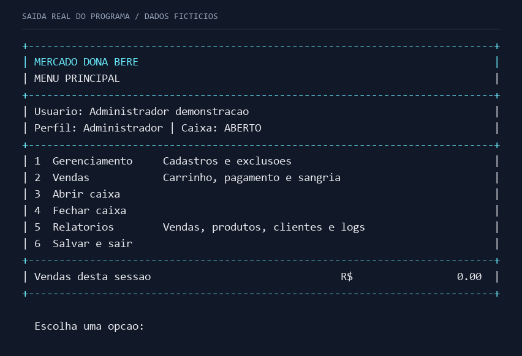
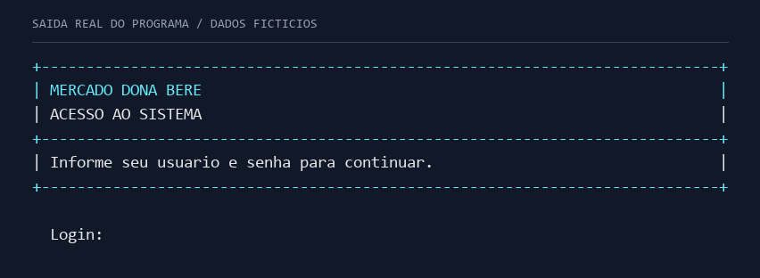
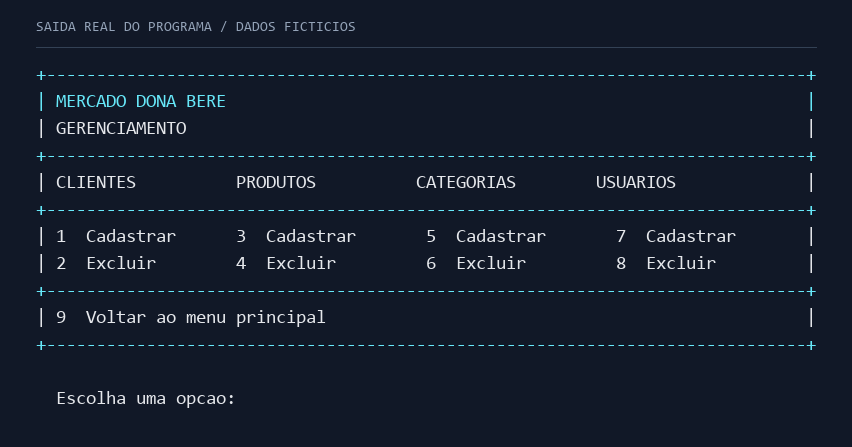
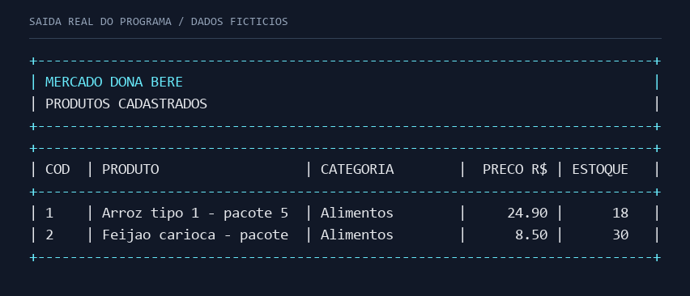
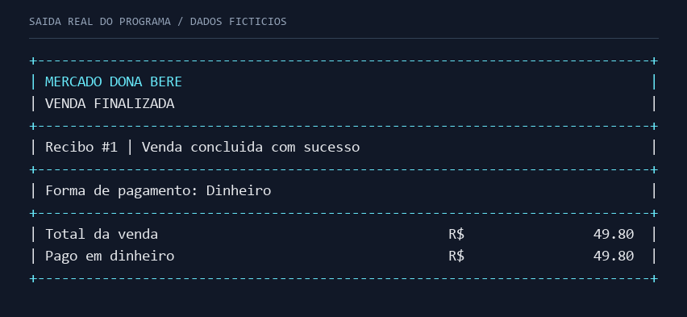
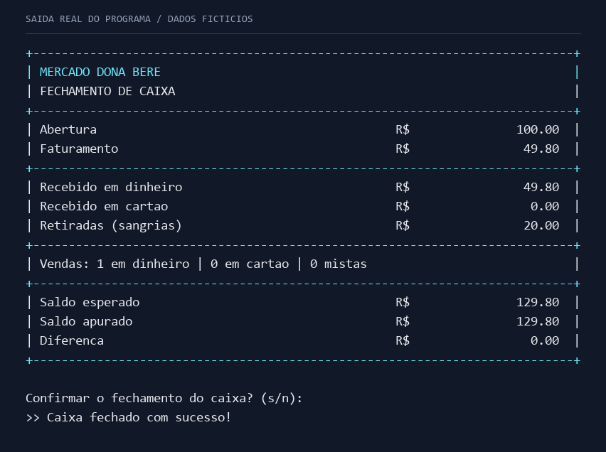

# Mercado Dona Bere

Sistema acadêmico de gestão de um mercado, desenvolvido em **C**, com interface de terminal. Reúne cadastros, controle de estoque, vendas e operações de caixa em uma aplicação local.

O projeto aplica estruturas de dados com **listas encadeadas**, alocação dinâmica de memória e persistência em arquivos binários. A versão principal é `bere_4.c`; as versões anteriores ficam em `versoes-antigas/`.



## Funcionalidades

| Área | Recursos |
| --- | --- |
| Acesso | Login local e perfis de administrador e colaborador. |
| Cadastros | Cadastro, listagem e exclusão de usuários, clientes, categorias e produtos. |
| Produtos | Categoria, preço de compra, margem de lucro, preço de venda, estoque e estoque mínimo. |
| Clientes | Dados cadastrais e validação dos dígitos verificadores do CPF. |
| Vendas | Carrinho com limite de 100 entradas e conferência da quantidade acumulada por produto. |
| Pagamentos | Dinheiro com troco, cartão demonstrativo, pagamento misto e cancelamento parcial. |
| Caixa | Abertura, sangria com saldo mínimo de R$ 50 e fechamento com conferência de saldo. |
| Relatórios | Resumo das vendas da sessão, listagens e consulta aos logs. |
| Persistência | Usuários, clientes, categorias e produtos em arquivos locais; estoque atualizado após a venda. |

O gerenciamento, o fechamento e as sangrias exigem perfil de administrador. A exclusão de categorias em uso e do usuário principal é bloqueada. O sistema também impede vendas com caixa fechado e a saída normal enquanto o caixa estiver aberto.

## Interface

Os menus usam bordas de **78 colunas**, tabelas com larguras fixas e valores com duas casas decimais. Títulos e separadores recebem destaque em ciano quando o terminal permite. Recomenda-se uma janela com pelo menos 80 colunas e fonte monoespaçada.

As imagens abaixo foram **renderizadas a partir da saída real das funções da aplicação**, executadas com dados fictícios. Elas mostram os fluxos existentes; não são capturas de uma janela do sistema operacional. Os textos correspondentes ficam ao lado dos PNGs em `docs/imagens/`.

### Login e gerenciamento





### Produtos e venda





### Fechamento de caixa

O exemplo registra abertura de R$ 100, uma venda de R$ 49,80 e sangria de R$ 20. O saldo esperado e o apurado são R$ 129,80, sem divergência.



## Tecnologias e organização

- C11 e biblioteca padrão de C.
- GCC para compilação.
- Listas encadeadas e gerenciamento manual de memória.
- Arquivos binários para os cadastros e arquivo de texto para logs.
- Funções de plataforma separadas da lógica principal.

```text
Bere/
├── bere_4.c           # Menus, cadastros, vendas, caixa e persistência
├── plataforma.c       # Terminal, formatação e preparação da pasta de dados
├── plataforma.h       # Declarações das funções de plataforma
├── README.md
├── docs/
│   └── imagens/       # Exemplos reais: PNG e saída em texto
├── dados/             # Criada automaticamente ao executar
└── versoes-antigas/   # Código histórico preservado por origem
```

Cada entidade tem sua própria lista e funções de cadastro, consulta, exclusão, salvamento e leitura. A organização mantém a lógica acessível para estudo, sem introduzir frameworks ou camadas adicionais.

## Compilar e executar no Windows

Requisitos: Windows, terminal e GCC/MinGW-w64 disponível no `PATH`. Uma distribuição portátil é o [WinLibs](https://winlibs.com/). Não há dependências gerenciadas por pacote.

Abra o PowerShell **na pasta `Bere`** e execute:

```powershell
gcc -std=c11 -Wall -Wextra -Wpedantic bere_4.c plataforma.c -o bere.exe -lm
.\bere.exe
```

Mantenha a pasta `Bere` como diretório de trabalho: os caminhos dos dados são relativos a ela.

No primeiro uso, o sistema cria a pasta `dados/` e o administrador inicial:

```text
Login: admin
Senha: admin123
```

A ausência inicial dos arquivos de cadastro ainda pode produzir mensagens de leitura no terminal; os arquivos são criados ao salvar os respectivos cadastros ou sair normalmente.

## Fluxo para experimentar

1. Entre com o administrador inicial.
2. Abra **Gerenciamento** e cadastre uma categoria.
3. Cadastre um produto nessa categoria, informando preço de compra, margem e estoque.
4. Volte ao menu principal e abra o caixa com um valor fictício.
5. Abra **Vendas**, informe o código do produto e a quantidade. Use `0` para finalizar o carrinho.
6. Escolha dinheiro, cartão ou uma combinação dos dois. Nos campos monetários, use ponto decimal, por exemplo `24.90`.
7. Confira os relatórios e faça o fechamento antes de salvar e sair.

## Validação desta revisão

A aplicação compilou no Windows com GCC 14.3.0, C11 e os avisos `-Wall -Wextra -Wpedantic`, sem avisos. Foram executadas **29 verificações funcionais em ambiente isolado**, todas aprovadas, cobrindo cadastros, login, permissões, persistência, exclusões, CPF, pagamentos, estoque, sangrias e fechamento.

Os exemplos da interface foram executados separadamente e tiveram as bordas de 78 colunas conferidas. Essas verificações não representam cobertura completa de todas as entradas possíveis.

## Limitações atuais

- O projeto é uma aplicação acadêmica local. As senhas são armazenadas em texto simples nos registros binários, e o login usa credenciais demonstrativas.
- O pagamento com cartão é uma simulação; não existe integração com operadora.
- Os valores monetários usam `float`, sujeitos a arredondamento.
- O resumo de vendas e o estado do caixa ficam em memória durante a sessão. Não há recuperação completa de uma sessão interrompida nem histórico estruturado de recibos.
- Os arquivos binários gravam estruturas de C e não possuem formato portável ou versionado.
- Há validações de negócio, mas o tratamento de entradas inválidas e textos longos ainda pode ser melhorado.
- Existe código condicional para Linux nas funções de plataforma. A execução desta revisão foi validada somente no Windows.
